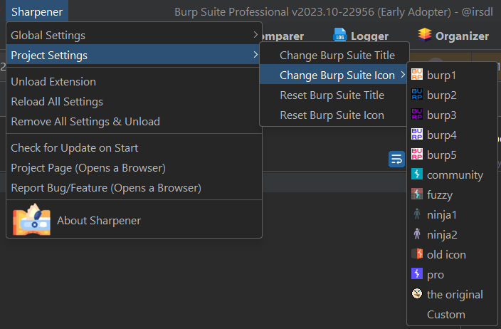
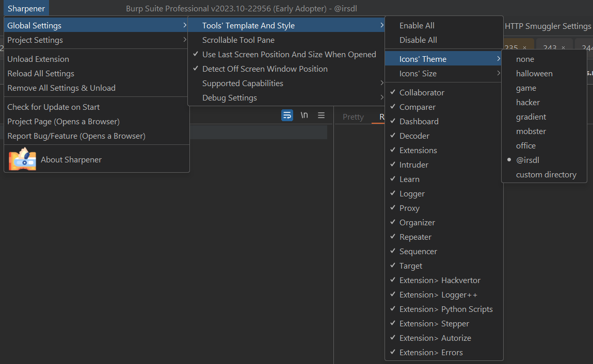
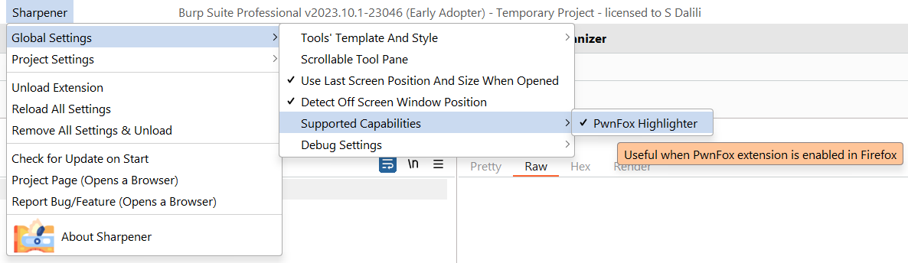

# Burp Suite Sharpener

This extension enhances Burp Suite by adding several UI and functional features, making it more user-friendly.

Refer to the "Burp Suite Compatibility and Reporting Errors" section for detailed information on compatibility.

```text
 ___  _                                      
/ __>| |_  ___  _ _  ___  ___ ._ _  ___  _ _ 
\__ \| . |<_> || '_>| . \/ ._>| ' |/ ._>| '_>
<___/|_|_|<___||_|  |  _/\___.|_|_|\___.|_|
                    |_|
```


## Installation

* Download the latest published jar from [/releases/latest](https://github.com/irsdl/BurpSuiteSharpenerEx/releases/latest).
* Add it to Burp Suite using the `Extensions` tab

## Features

* Making main tools' tabs more distinguishable by choosing a theme
* Ability to control style of sub-tabs in Repeater and Intruder
* Ability to change Burp Suite title and its icon
* Copy & pasting style ability for Repeater and Intruder tabs
* Pasting style for Repeater and Intruder tabs when their title matches a Regular Expression
* Copy & pasting titles by creating unique titles by adding a number in the end
* Rename titles without a need to double-click on the title
* Jump to first and last tabs in Repeater and Intruder
* Back and Forward feature depends on the previously selected tabs
* Finding Repeater and Intruder tabs when their title matches a Regular Expression
* Scrollable main tool tabs
* Scrollable Repeater and Intruder tabs
* Taking screenshot of repeater or intruder tabs
* Trimming long titles into 100 characters
* Show previously chosen titles for a tab
* Several keyboard shortcuts to make the tab navigation easier, viewable and customisable inside Burp
* Keyboard shortcut to jump from a tab into the HTTP request editor and back to the tab
* Support for PwnFox Firefox extension highlighter
* Ability to save the last size and position of Burp Suite to move it to the same location next time
* Ability to detect off-screen Burp Suite window to bring it to the centre
* Ability to highlight HTTP and WebSocket requests in proxy by detecting the "tempcolorCOLORNAME" pattern and removing it
* Ability to highlight HTTP and WebSocket requests and responses in proxy by detecting the "permcolorCOLORNAME" pattern
* Logger HTTP highlighting using the same markers, including traffic sent by other Burp tools

## Burp Suite Compatibility and Reporting Errors

Sharpener targets current Burp Stable and Early Adopter, including Community Edition. The latest Windows Professional Early Adopter 2026.11 run passed 23 automated UI case groups, including real Proxy/Logger marker colouring, with no failed assertions. An earlier 4.93 jar passed 21 groups in Community 2026.3.3; the expanded highlighter rerun timed out at startup before any assertions ran. Clipboard testing and eight manual groups remain pending. Current Stable, other 2026 releases, macOS and Linux remain unverified. See the exact jars and results in the [live evidence](docs/full-ui-validation.json).

Java 21 is required (Burp 2024.2 or later). This bytecode baseline does not establish API compatibility with every older Burp release. See the [host validation checklist](docs/burp-ui-compatibility.md) and [current compliance findings](docs/portswigger-compliance.md).

Releases are prepared from `main`. Version 4.93 is unreleased; see [CHANGES.md](CHANGES.md) for the change history.

We actively use this extension and occasionally observe potential errors, particularly when Burp Suite updates its core functionalities or UI. As an open-source project, we heavily rely on community feedback for enhancements and bug fixes. If you encounter any issues, kindly report them on our [issues page](https://github.com/irsdl/BurpSuiteSharpenerEx/issues). Additionally, if you value our work, please consider [sponsoring](https://github.com/sponsors/irsdl) this project.

## Using the Legacy Extension

For Burp versions outside the targets described above, the legacy extension and original repository remain available. Compatibility with every earlier 2026 release has not been established.
The older versions of this extension can be downloaded from the legacy branch (with no support):

* [Legacy-Extension branch releases](https://github.com/mdsecresearch/BurpSuiteSharpener/tree/Legacy-Extension/release)
* [Original repository releases](https://github.com/mdsecresearch/BurpSuiteSharpener/releases)

## About This Repository

Continuation of the Burp Suite Sharpener project, originally released as open source by [MDSec](https://www.mdsec.co.uk/) at [mdsecresearch/BurpSuiteSharpener](https://github.com/mdsecresearch/BurpSuiteSharpener).

## Suggesting New Features

The plan is to add simple but effective missing features to this single extension to make tester's life easier as a must-have companion when using Burp Suite (so we cannot Burp without it!).

Please feel free to submit your new feature requests using `FR: ` in its title in [issues](https://github.com/irsdl/BurpSuiteSharpenerEx/issues).

It would be great to also list any known available extensions which might have implemented suggested features.
Perhaps the best features can be imported from different open-source extensions so the overhead of adding different extensions can be reduced.

## Keyboard Shortcuts

All Sharpener shortcuts can be viewed and changed inside Burp: use the `Sharpener` top menu > `Keyboard Shortcuts`, or the `Keyboard Shortcuts` item at the bottom of a Repeater/Intruder tab right-click menu. Changes are validated (Burp's own default hotkeys such as Ctrl+R cannot be taken) and applied right away.

Each configurable action has ONE shortcut. In the dialog you set it by clicking the cell and pressing the key combination (no typing). A shortcut works anywhere in Burp, even while typing in the editor, so it needs Ctrl, Alt, or a function key. If you press a key that is already used, the dialog offers to move it.

Configurable shortcuts for the Repeater and Intruder tabs (defaults):

| Action                          | Shortcut       |
|---------------------------------|----------------|
| Previous Tab                    | Ctrl+PageUp    |
| Next Tab                        | Ctrl+PageDown  |
| First Tab                       | Alt+Home       |
| Last Tab                        | Alt+End        |
| Focus Tab (from the editor)     | Alt+Up         |
| Show Tab Menu                   | Ctrl+Enter     |
| Find Tabs (RegEx)               | Ctrl+Shift+F   |
| Find Next                       | F3             |
| Find Previous                   | Shift+F3       |
| Back (previously selected tab)  | Alt+Left       |
| Forward                         | Alt+Right      |
| Copy Tab Title                  | Ctrl+Shift+C   |
| Paste Tab Title                 | Ctrl+Shift+V   |
| Rename Tab Title                | F2             |

Fixed tab-header keys (always on when a tab title has the focus, not editable):

| Action                | Key         |
|-----------------------|-------------|
| Previous Tab          | Left Arrow  |
| Next Tab              | Right Arrow |
| First Tab             | Home        |
| Last Tab              | End         |
| Enter Request Editor  | Down Arrow  |

These plain keys only act when a tab header has the focus, so they never disturb the editor. Click a tab title (or use a shortcut jump) to focus the header, then use the arrows to move between tabs and Down to drop into the request editor to edit it. Use Alt+Up (or click) to go back to the tab. After a keyboard jump that started on the header, the focus stays on the header, so pressing an arrow several times keeps navigating.

Notes:

* Ctrl+C and Ctrl+V are unassigned by default, so a paste can never rename a tab by accident. Copy and paste titles use Ctrl+Shift+C and Ctrl+Shift+V, and a pasted title can be reverted from the tab menu under Previous Titles.

Default shortcut for the main Burp window:

| Action                                             | Shortcut   |
|----------------------------------------------------|------------|
| Move Burp Suite Window to the centre of the Screen | Ctrl+Alt+C |

Fixed mouse actions on the Repeater and Intruder tabs (not configurable):

| Action                       | Mouse combination                       |
|------------------------------|-----------------------------------------|
| Show Tab Menu                | Middle-Click<br/>Alt + Any Mouse Key    |
| Scroll Through Tabs          | Mouse Wheel (when enabled in the menu)  |
| Increase Font Size           | Ctrl + Mouse Wheel Up                   |
| Decrease Font Size           | Ctrl + Mouse Wheel Down                 |
| Increase Font Size & Bold    | Middle-Click + Ctrl                     |
| Decrease Font Size & Bold    | Middle-Click + Ctrl + Shift             |
| Big & Red & Bold             | Middle-Click + Shift                    |

## Usage Tips

* After setting style on a sub-tab, setting the same title on another sub-tab will copy its style
* Alt + Any Mouse Click works on empty parts of the tabs which do not contain any text
* Use the `Debug` option in `Global Settings` if you are reporting a bug or if you want to see what is happening
* Check the [extension's GitHub repository](https://github.com/irsdl/BurpSuiteSharpenerEx) rather than BApp Store for the latest updates
* Sample icons are available in the [burpicon-sample/](burpicon-sample/) and [hacker-sample-icons/](hacker-sample-icons/) directories











## Contributing

Pull requests are welcome. Pushes and releases have separate validation gates:

* AI-assisted maintenance follows [AGENTS.md](AGENTS.md), including the dependency, toolchain, and GitHub Actions admission policy.
* Before every push, review the live PortSwigger guidance and update the [compliance evidence](docs/portswigger-review.json), then run `./gradlew verifyPushReadiness --offline --dependency-verification strict`. Enable the versioned pre-push hook in each clone with `git config --local core.hooksPath .githooks`; preserve existing custom hooks. See the [full procedure](docs/portswigger-compliance.md).
* Review the dated [dependency evidence](docs/dependency-review.md) before updating locks or verification hashes. Acquire reviewed inputs with `./gradlew resolveDependencies --dependency-verification strict`, then build with `./gradlew build --offline --dependency-verification strict`.
* Submit changes through pull requests into `main`; maintainers must configure the required GitHub checks.
* Build with `./gradlew build` (requires JDK 21); this runs the tests headless and verifies packaging. `jar` alone is insufficient validation.
* Full live UI regressions are opt-in: use `./gradlew fullUiTestPlan` to list cases and follow [the full UI suite guide](docs/full-ui-tests.md) to run `fullUiTest` after major changes. These heavy tests are excluded from normal builds, quick tests and the production jar.
* New or changed behaviour must be covered by test cases in `src/test/java`. The extension cannot run outside Burp Suite, so tests use mocked Montoya interfaces and plain Swing components.
* Compatibility work targets both Burp Stable and Early Adopter. See the [compatibility design and host validation checklist](docs/burp-ui-compatibility.md); simulated layouts do not replace loading the jar in both release channels.
* Keep Windows, macOS and Linux supported. Native changes need guarded portable paths and live evidence for each OS/channel before release; see [platform icons and dynamic host testing](docs/platform-icons-and-testing.md). Windows icon changes apply to running windows, preserving existing launcher files and pinned shortcuts.
* Publication is manual and currently blocked by unresolved compliance/security/host evidence. CI uses read-only permissions and never publishes or deletes releases/tags. Before any tag push, GitHub release/asset upload or BApp submission, complete the [release checklist](docs/portswigger-compliance.md) and pass `./gradlew verifyReleaseReadiness --offline --dependency-verification strict`. Passing checks does not itself authorize publishing. For a release:
  * Bump `version` in `src/main/resources/extension.properties`. It must stay parseable as a number (for example `4.7`), because the update checker compares it numerically.
  * Add a brief, factual section at the top of [CHANGES.md](CHANGES.md) with the exact heading format `## Version X.Y (YYYY-MM-DD)`. Mark it unreleased until publication; use it for release notes after the release gates pass. CI does not publish releases.

## Thanks To

* Corey Arthur [CoreyD97](https://twitter.com/CoreyD97) for [Burp-Montoya-Utilities](https://github.com/CoreyD97/Burp-Montoya-Utilities/). A small part of it (the preferences classes) is now maintained inside this repository under `libs/thirdparty/`; the rest of the library is no longer bundled. See the NOTICE file.
* Bruno Demarche (for initial Swing hack inspiration)

Please feel free to report bugs, suggest features, or send pull requests.

## License

Copyright (C) 2021-2026 Soroush Dalili ([@irsdl](https://github.com/irsdl)).

Released under the GNU Affero General Public License v3.0 with additional terms under section 7 of the license: copies and modified versions must keep the copyright notices and the "Developed by Soroush Dalili (@irsdl)" attribution. See the [LICENSE](LICENSE) and [NOTICE](NOTICE) files.
